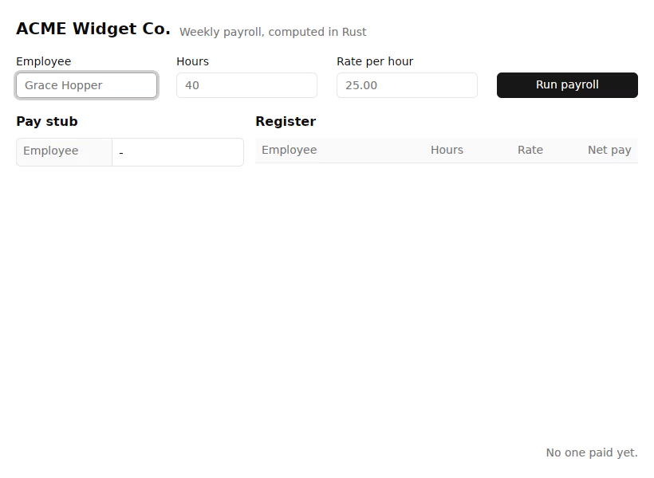

# Payroll in Rust

The payroll app of [../../cobol/payroll.cob](../../cobol/payroll.cob), written
directly against gpui and gpui-component (same pins as gpuifs), as one half of
a timing experiment: the same app built in rc on gpuifs vs. in Rust. Built to
[SPEC.md](SPEC.md) in 3 min 6 s of wall time; see [RESULTS.md](RESULTS.md).

    cargo build --release && ./target/release/payroll
    cargo test --release --lib       # the arithmetic
    ./capture.sh                     # the reference run, on Xvfb :99

