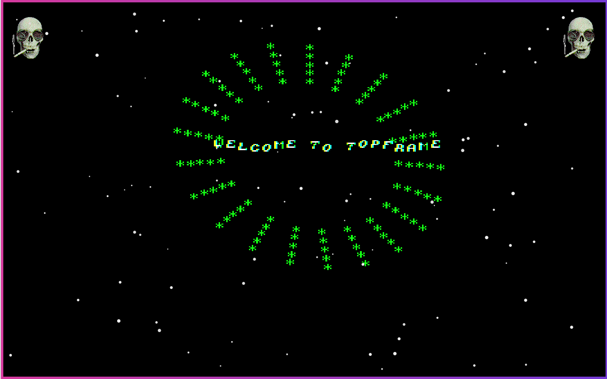

# Topframe on uitree

[Topframe](https://github.com/progrium/topframe) puts a local webpage over
the whole screen: a fullscreen, transparent, click-through, always-on-top
web view, reloaded whenever a file in `~/.topframe` changes, with a menu
bar extra (🔲) to turn it off, make it interactive, show the source
directory or quit. Executable files in the directory can be called from
the page with an `EventSource`; each line of their output is an event.

This is the same program as a uitree app. Topframe's Go program serves
the directory and watches it, then drives Cocoa through macdriver; here
the serving and watching are the same Go code, running in h9, and the
Cocoa part is a few uitree files.

```
apps/topframe/
  main.go       the client: HTTP server, script streams, watcher, the UI
  data/         Topframe's demo page and assets, served at /-/data/
  build         fetches the large demo media, builds topframe-client
  topframe      the launcher: Topframe's flags, ~/.topframe, runs uitree
```



Topframe's demo page, fullscreen in uitree's GPUI renderer on Linux
(Xvfb). The page itself is transparent; on Linux the WebKitGTK view
still paints black under it, which is a web node issue. On macOS,
WKWebView over a transparent window is what Topframe itself does.

## Running it

```sh
cd uitree/renderer/gpui && cargo build --release -p uitree
cd ../../apps/topframe && ./build
UITREE=../../renderer/gpui/target/release/uitree ./topframe
```

`topframe -h`, `-version`, `-docs` and `-plist` work as Topframe's do.
`-plist` prints a launch agent that runs this launcher at login:

```sh
./topframe -plist > ~/Library/LaunchAgents/com.progrium.Topframe.plist
```

The launcher runs `uitree --net enable -C ~/.topframe ./topframe-client`.
`--net enable` lets the client serve on a host port, which h9 refuses by
default; it listens on 127.0.0.1 only.

## Topframe to uitree

| topframe.go | uitree |
| --- | --- |
| `TerminateAfterWindowsClose = false` | `set app agent` |
| `NSBorderlessWindowMask`, `NSScreen_Main().Frame()` | `set . titlebar=none fill=display` |
| `SetLevel(NSMainMenuWindowLevel + 2)` | `set . top=overlay` |
| `SetLevel(NSMainMenuWindowLevel - 1)` when interactive | `set . top=on` |
| `NSWindowCollectionBehaviorCanJoinAllSpaces` | `set . all-spaces=on` |
| `setHasShadow: false` | `set . shadow=off` |
| `SetOpaque(false)`, `NSColor_Clear()` | `set . transparent=on` |
| `SetIgnoresMouseEvents(true/false)` | `set . click-through=on/off` |
| `WKWebView`, `LoadRequest`, `drawsBackground = false` | `web page url=http://127.0.0.1:PORT/ : bg=#00000000` |
| `developerExtrasEnabled` | the web node's inspector (always on) |
| `wv.Reload` on a file event | `reload` on `win/main/page/ctl` |
| `orderOut:` / `orderFront:` (Enabled) | `state hidden` / `state normal` |
| `NSStatusBar` item and `NSMenu` | `tray main title=🔲 menu=tray`, `menu/tray` |
| `menuItem.SetState`, `SetEnabled` | `set interactive check=on`, `set interactive enabled=off` |
| `exec.Command("open", dir)` (Show Source) | `open file:///Users/you/.topframe` |

## Differences

- **Scripts run in h9**, in the app's sandbox, not on the host. The demo
  `stocks` script is rc and uses `hget` where Topframe's was sh and curl,
  so it needs a 9front root (`--root`, or `$H9ROOT`); a `#!/bin/sh`
  script needs the Linux view (`-d ALPINE:#L`). The page and the
  directory work with the built-in root.
- **The port is not random from the OS.** h9's `/net/cs` can't translate
  port 0, so the client tries free ports from 40000 up. `TOPFRAME_ADDR`
  picks one, as in Topframe.
- **Watching polls**, every 450 ms, as progrium/watcher does.
- **Other platforms.** The window props and the tray are native on macOS.
  On Windows, `top` and `fill` work, and the tray shows. On Linux the web
  view, `fill`, transparency and click-through work; `top`, `all-spaces`
  and the tray don't yet, and the web view isn't see-through yet.
