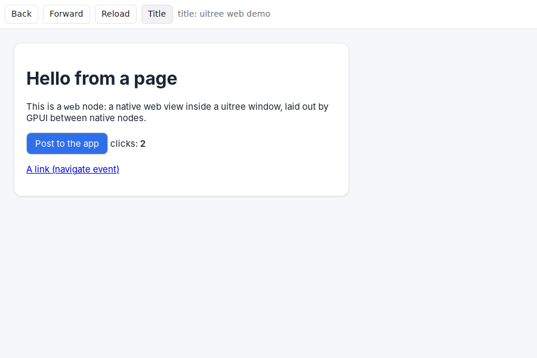

# renderer/gpui

The GPUI host, in Rust. The only Rust in uitree (plus `tools/style-gen`,
a build tool).

It draws the committed tree and turns input into events. It reads the tree
in place through `uitcore.h` and never decides whether a write is valid:
a renderer change that adds a protocol error string is wrong.

Layout (the spike, W0, created it; W6 fills it). Status: below, and
[../../SPIKE.md](../../SPIKE.md) for the spike.

```
Cargo.toml             workspace
crates/uitcore-sys/    hand-written bindings to ../../core/include/uitcore.h;
                       build.rs runs `zig build -Doptimize=ReleaseSafe` for
                       Cargo's target and links libuitcore.a
crates/uitcore/        the safe wrapper: borrowed reads, UitChanges, input
crates/host/           components, materialize, style dispatch (from uitreefs/crates/host);
                       build.rs embeds core/types/*/spec, style-words, theme-tokens, themes
crates/uitree/         ~50-line main: create the core, hand control to GPUI
tools/style-gen/       from uitreefs/crates/style/gen; emits the dispatch table
                       here and core/types/style-words, theme-tokens, themes (W1)
```

Build and run (Linux needs `libxkbcommon-dev libxkbcommon-x11-dev`, and
`libwebkit2gtk-4.1-dev libgtk-3-dev` for the `web` node; see below):

```
cargo test                                   # uitcore-sys, uitcore: no display needed
cargo build --release -p uitree
cd examples && H9ROOT=/path/to/9front/root ../target/release/uitree -t Counter rc counter.rc
../target/release/uitree --bench 2000        # FFI cost per frame
```

On macOS, h9 needs the `com.apple.security.hypervisor` entitlement:
`tools/sign target/release/uitree` signs a build with hyper9's
`h9.entitlements` (a no-op on other systems), and `.cargo/config.toml`
makes `cargo run` and `cargo test` sign before they run.
`tools/shoot-examples` runs every 0.2 example from the release binary
under Xvfb and saves a screenshot of each (CI uploads them).

`H9ROOT` is a 9front root with `rc` in it: in `third_party/hyper9`,
`scripts/fetch.sh isoamd64` then
`zig build isoroot -- .local/9front/9front-11952.amd64.iso .local/9front/root-amd64`.
With no KVM, h9 uses its native backend.

## How the host reads the tree

Every component reads its node through `NodeView` (`crates/host/src/lib.rs`),
which reads the core through `uitcore`: props, parsed lines, children, the
parsed style. `runtime::Inner` keeps one cache entry per node (props, lines
and the mapped `ParsedStyle`), dropped when a pump says the prop changed,
so a frame reads each value from the core once. Input goes back as
`uit_emit`, `uit_request` and `uit_mirror`, queued by listeners and handed
to the core in order on the main thread. Host commands from the pump
(`UIT_CMD_*`) open windows, run window and component verbs, set menus,
keys and the theme. The renderer holds no protocol error strings and no
ctl parser: `Ctl` is the core's already-parsed command.

Themes: the host registers GPUI Kit's whole theme set with `uit_themes`,
as the palettes `tools/style-gen` resolves from gpui-component's
`themes/*.json` (`core/types/themes`). The core owns `theme/name` and
resolves every token through the selected palette; `theme.rs` copies the
tokens into GPUI Kit's `ThemeColor` on `UIT_CMD_THEME`, as it does for
`theme/tokens`. The look tokens, read as text with `uit_token_text`, set
`Theme`'s `radius`, `radius_lg`, `font_size`, `font_family` (`system` is
GPUI Kit's own) and `shadow`; `spacing` sets every window's rem size (4
times the step), so the Tailwind scale words and rem text sizes follow it.
`theme load PATH` still loads a GPUI Kit JSON file directly.

Style: the core hands over parsed words (`uit_style`), tokens already
resolved to RGBA. `styling.rs` maps them with the dispatch table that
`tools/style-gen` generates (W1); `every_table_word_resolves` checks that
every word in the table has a mapping.

Types: the host registers the descriptors of the components it draws
(`spec::registration`), from `core/types/NAME/spec`.

## Tests

```
cargo test -p host       # GPUI test platform, no display needed
```

`testing::Harness` runs the real core: it listens on a private socket, a
9P client on another thread writes `$ui` as an app would, and the test
thread pumps until the write is acked, then draws. A write the core
refuses comes back as a `WriteError` with its 0.2 error word. Events come back by
reading `events` over 9P. Paths are 0.2 (`win/main/f/ok`).

`tests.rs` covers the host and the element tier; `components/*/tests.rs`
and `canvas/render_tests.rs` cover each component group: 99 tests, all
passing on W3's core. They are the uitreefs render tests in the 0.2
spelling. Where 0.2 decides differently, the test follows the spec and
says so in a comment:

- Variants and sizes are bare words on `new`/`set` (`button b primary`),
  not style words.
- There is no `append` file; a client rewrites `rows`.
- A child the parent can't hold is `unknown type`, not `bad value`.
- `progress` has no range on `value`.
- A context menu or menu button item sends `action ID - via=menu` to the
  app's `events`, as the menu bar does.
- `trace` is a stream, read like `events`.
- Hidden `main` needs content or `show` to open, even after `window main`.

The gallery stories the tests load are copied, converted to 0.2, into
`crates/host/fixtures/gallery/`.

## Examples

All 30 examples in
[tests/conformance/examples/list](../../tests/conformance/examples/list)
(uitreefs's examples, ported: rc apps and awk, C, COBOL, Forth, Go, jq,
Lua, Node, PostScript, Python, Ruby, Scheme, sed and sh clients) run in h9
under Xvfb. `tools/shoot-examples [OUTDIR] [NAME...]` screenshots each
once its tree is built; the Linux clients need `$LINUXROOT`
(`../../tools/linuxroot`) and run with `-d $LINUXROOT:#L`, which
`uitree -d SRC[:DST]` and `-e NAME=VALUE` pass to h9 for any app.
Screenshots: [examples/screenshots/](examples/screenshots/).

## The `web` node

`web` (components.md § New in this spec) is a page in a node, in
`crates/host/src/components/web/`. On the desktop it is GPUI Kit's
`gpui-webview`, a wry child view (WKWebView, WebView2, WebKitGTK) kept on
the node's layout box each frame, behind the host's `webview` feature (on
by default; `--no-default-features` builds a placeholder that shows the
URL). In the browser build it is an `<iframe>` over the canvas. The
terminal renderer draws a box naming the page.

- A native view sits above GPUI's drawing: a menu, popover or tooltip
  that overlaps the node is drawn under the page.
- On Linux, WebKitGTK embeds only in an X11 window, so with the feature on
  the host runs on X11 (or XWayland), never native Wayland.
- `url`, `html` (wins when both are set) and `script` (before the page's
  scripts on every load; changing it rebuilds the view). `reload`, `back`,
  `forward`; `eval n=N script=TEXT` answers `result - PATH n=N ok=on` with
  the value in `result`; `uitree.post(text)` in the page sends `message -
  PATH n=N` with the body in `message`. `load`, `title value=T`, `navigate
  url=U allowed=on`. The page gets autoplay and the inspector, and a
  `bg=transparent` node a transparent page background.
- Where this differs from components.md, because of the core: flags in
  event lines are `ok=on`, `allowed=on`, and `message` and `result` hold
  the latest body rather than being `message/N` and `result/N`
  directories. Every navigation is allowed.

`examples/web-host` is a demo client on the host (it dials the core over
9P, so it needs no h9 root): `go build -o web-host . &&
UITREE_HOST_APP=$PWD/web-host ../../target/release/uitree -k`.


## What the core does not offer yet

- The clipboard has no ABI call to read the platform's text back, so the
  host only writes it.
- The `message-list`, diagnostics and completion line formats are not in
  components.md 0.2; the host parses them from the prop text as uitreefs
  did.
