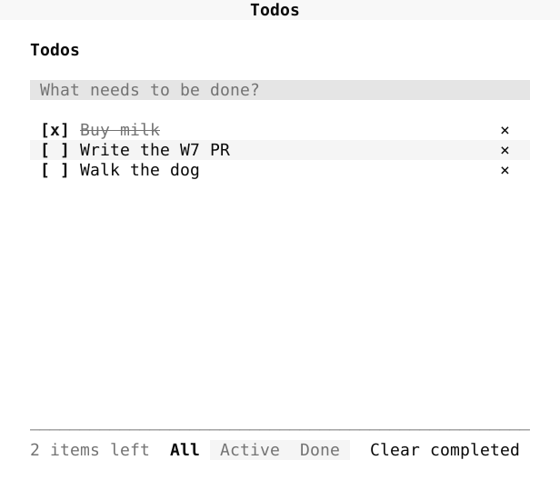

# renderer/tui

`uitree-tui`, the terminal host: the core (libuitcore) runs the app in h9
and serves `$ui`; this draws the app's `main` window in a terminal with
[libvaxis](https://github.com/rockorager/libvaxis), lays it out with
[Yoga](https://github.com/facebook/yoga), and sends keys and the mouse
back. Workstream W7.



```sh
zig build                                  # zig-out/bin/uitree-tui (links h9)
zig build test -Dh9=false                  # unit tests, no h9 needed
H9ROOT=<9front root> zig-out/bin/uitree-tui -t Counter rc counter.rc   # from examples/
```

Zig 0.16, the core's pin. `H9ROOT` (or `--root DIR`) is a 9front root for
h9, such as the one hyper9 makes:

```sh
cd ../../third_party/hyper9 && scripts/fetch.sh isoamd64 &&
  zig build isoroot -- .local/9front/9front-11952.amd64.iso .local/9front/rootamd64
```

Ctrl-C or Ctrl-Q closes the window. The app's output and the host's log
go to `--log FILE` (default `/tmp/uitree-tui.log`), since the terminal
belongs to the UI. `--dark` starts in the dark theme. `--colors
truecolor|256|16` overrides the color depth `COLORTERM` suggests.

## The boundary

- The core is linked as `libuitcore.a` and seen only through
  `include/uitcore.h`, translated by `translate-c` into the module `c`
  ([src/c.h](src/c.h)). Nothing here imports the core's Zig modules.
  [src/core.zig](src/core.zig) is a thin face on the header.
- The renderer reads the committed tree (`uit_children`, `uit_type`,
  `uit_prop`, `uit_style`), pumps on `wake`, and sends input with
  `uit_emit`, `uit_mirror` and `uit_key`. It never parses `ctl`, never
  formats an event line, and never makes a protocol error.
- [src/ui.zig](src/ui.zig) reads through `Source`
  ([src/source.zig](src/source.zig)), which is the ABI in the app and a
  small in-memory tree in the unit tests.

## What it registers (I6, I7)

[types/](types/) holds copies of the descriptors of the types it draws,
from W1's `core/types/` ([types/gen.sh](types/gen.sh) copies them and
writes `types.zig`), plus `style-words` and `theme-tokens`, which it
passes to `uit_create` unchanged so the core accepts the same style
vocabulary as GPUI and an app runs on either host, and `themes`, GPUI
Kit's theme set as palettes, which it registers with `uit_themes`: an
app's `theme/name Catppuccin` picks the same colors here as on GPUI.

| Profile | Types |
| --- | --- |
| `core` (all) | `div` `text` `styled-text` `img` `svg` `icon` `scroll` `spacer` |
| `form` (all) | `button` `checkbox` `radio-group` `switch` `select` `input` `textarea` `number-input` `slider` `form` `field` |
| extras the examples need | `link` `tabs` `tab` `empty` `separator` `badge` `kbd` `progress` `spinner` `alert` `dialog` |

Every other type is left out, so the core refuses `new` for it with
`unknown type`, and an app degrades with `alt=` as components.md's
Degrading section says.

## How it draws

**Cells.** Styles are in GPUI points; a cell is taken as 8 points wide
and 16 tall. Lengths convert on the axis they apply to (`p=16` is two
columns at the sides and one row above and below), columns rounding to
nearest and rows rounding down unless three quarters full, so 8-point
vertical gaps collapse instead of doubling a form. Tailwind scale words
(`p-4`, `gap-2`, `w-1-2`) are 4 points a step, or what the `spacing`
look token says; `radius 0` squares every rounded box corner. The other
look tokens (font size and family, shadow) have nothing to change in a
cell grid. A border is a whole cell,
so a bordered box written 2 rows tall gets 3.

**Layout.** Every node is a Yoga node. A div with no direction stacks
its children, as GPUI's block divs do; `flex`, `h-flex`, `v-flex`,
`items-*`, `justify-*`, `self-*`, `flex-1`, `flex-grow`, sizes, min and
max, padding, margin, gap, `absolute` with insets, `overflow-*` and
`hidden` map one to one. The window's root fills the terminal under a
one-row title bar (the root's `title`).

**Looks.** Colors arrive as RGBA with theme tokens already resolved
(through the named theme's palette, when the app picked one); the grid
blends translucent ones over what is under them and draws them at the
terminal's depth ([src/color.zig](src/color.zig)): 24-bit when
`COLORTERM` is `truecolor` or `24bit`, else the nearest xterm-256 color
(the cube and the gray ramp, never the 16 the user's terminal theme
redefines), or the nearest ANSI color with `--colors 16`. `text-color`, `font-semibold`/`font-bold`, `italic`, `underline`,
`line-through`, `font-light` (dim), `text-center`/`text-right`,
`truncate` and `whitespace-nowrap` inherit down the tree like GPUI's text
style. `hover:`, `active:`, `focus:` and `disabled:` words apply when the
pointer, a press, or focus is on the node. Shadows, cursors, font
families and text sizes are accepted and not drawn.

**Components.**

| Type | In the terminal |
| --- | --- |
| `button` | a filled row with the label; variants from `button-*` tokens; `›` when focused |
| `checkbox`, `switch` | `[x] Label`, `━━● Label` |
| `radio-group` | `(•) Item` per line of `items` (or a row with `dir=row`) |
| `input`, `number-input` | a one-row well with a caret; `secret` shows `•`; `−`/`+` at the ends of a number input |
| `textarea` | `rows` rows (default 3), hard lines, scrolls to the caret |
| `select` | a well with `▾`; Enter or a click opens a list under it |
| `slider`, `progress` | `━━━●───`, `████░░░` |
| `form`, `field` | a column; label in bold with `*` when `required`, then the control, `description` muted, `error` in the danger color |
| `tabs` | a row of labels on a muted strip, the selected one bold; the selected tab's children below |
| `link` | underlined, an OSC 8 hyperlink to `href` |
| `scroll` | clips and scrolls with the wheel |
| `empty`, `alert`, `badge`, `kbd`, `separator`, `spinner`, `icon` | glyphs: `▭ Nothing to do`, a bordered box, ` 3 `, ` ⌘K `, `───`, `⠋`, `×` |
| `img`, `svg` | `[image name]`, dim |
| any node's `tooltip` file | one row in popover colors above the node (below it on the top row), 500 ms after the pointer rests on it, hidden when the pointer leaves or presses; nothing is sent to the client. The `tooltip` overlay type isn't registered (no `overlay` profile) |
| `dialog` | from `uit_overlays`: centered over a scrim, opaque, bordered, title, description, children, `footer` last; while one is open, focus and Tab stay inside it, and focus goes back when it closes |

**Input.** Tab and Shift-Tab move focus between controls in tree order.
A focused control takes the keys it uses (typing in inputs, Space and
Enter on buttons and checkboxes, arrows on radio groups, tabs, sliders
and number inputs); every other keystroke goes to `uit_key` spelled as
`$ui/keys` spells it (`ctrl-shift-p`, `=`, `enter`), so app key bindings
work. The mouse clicks, hovers, drags sliders and scrolls. A click on a
node whose `on` includes `click` (the counter's divs) emits `click` on it
with `x=`, `y=` (window points, cells × 8 and × 16) and `button=left`.
Edits mirror `value` and send `change value=` (no value for a `secret`
input); Enter sends `submit` from the enclosing form, or the input.
Each drawn node's rect goes to `uit_bounds` in window points, for its
`bounds` file.

## Examples

[examples/](examples/) has counter, hello, signin and todo in the 0.2
spelling. Each was run under h9 on the 9front 11952 amd64 root in xterm,
driven by [tools/shoot.sh](tools/shoot.sh) (Xvfb, xterm and tmux, which
sends the keys and SGR mouse reports), which also records the
screenshots and GIFs in [examples/screenshots/](examples/screenshots/).

| Example | Shows | Recording |
| --- | --- | --- |
| counter | `on=click` divs, `hover:` and `active:` styles, a `=` key binding | [counter.png](examples/screenshots/counter.png), [counter-after.png](examples/screenshots/counter-after.png), [counter.gif](examples/screenshots/counter.gif) |
| hello | a `tree` document, input + primary button sharing a tag, Enter submits, reading `value` | [hello.png](examples/screenshots/hello.png), [hello-greeted.png](examples/screenshots/hello-greeted.png), [hello.gif](examples/screenshots/hello.gif) |
| signin | form and fields, `required`, field errors, a secret input, a link, a dialog in `over/` opened with `open` | [signin.png](examples/screenshots/signin.png), [signin-errors.png](examples/screenshots/signin-errors.png), [signin-welcome.png](examples/screenshots/signin-welcome.png), [signin.gif](examples/screenshots/signin.gif) |
| todo | new and delete per item, checkbox `change`, tabs filtering through `order`, scroll, empty state, `hover:` rows | [todo.png](examples/screenshots/todo.png), [todo-items.png](examples/screenshots/todo-items.png), [todo-active.png](examples/screenshots/todo-active.png), [todo-cleared.png](examples/screenshots/todo-cleared.png), [todo.gif](examples/screenshots/todo.gif) |

They follow uitreefs's versions, except that todo's delete buttons are
always shown: `group-hover` is a uitreefs extra that 0.2 doesn't have.

## Not done yet

Menus (`uit_menu_bar` is ENOTSUP; a terminal menu bar would be a row of
labels with a dropdown), several windows (only `main` is drawn),
`styled-text` runs, drag and drop, the clipboard, mouse-wheel scrolling of
inputs, soft wrapping in a textarea, and a spinner that spins (it needs a
timer in the loop).
