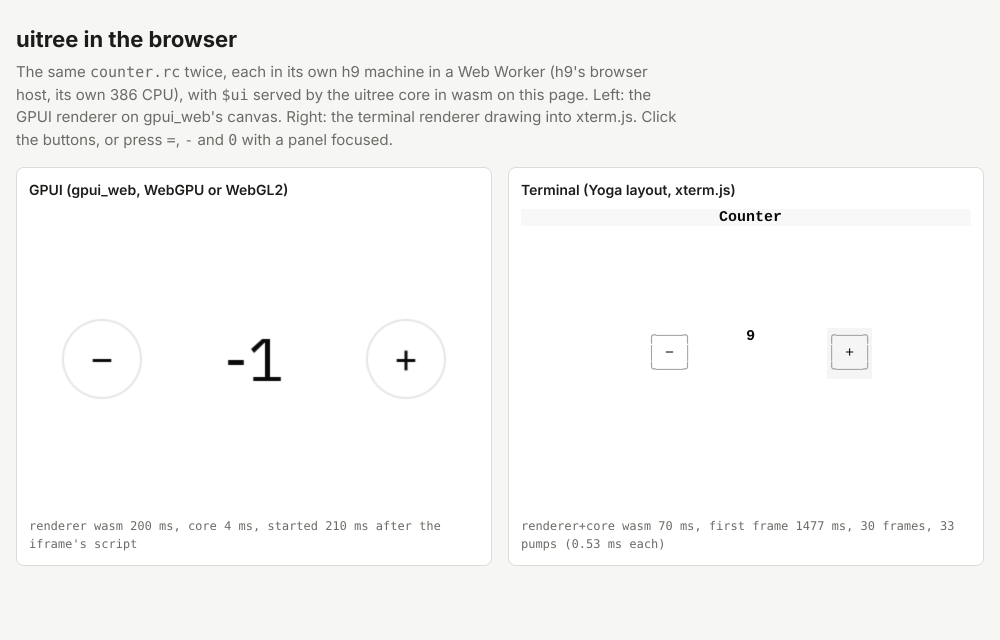

# uitree/web: uitree in the browser (spike)



Both renderers in a browser page, fully client-side: no server-side h9 and
no DOM renderer. `index.html` runs `counter.rc` twice, once on each
renderer.

```
page (main thread)                                   Worker, one per app
  GPUI renderer     uitree_web.wasm (core linked in)   h9's browser host, unchanged
    └ gpui_web canvas                                     h9.wasm, its 386 CPU (h86)
  terminal renderer uitree-tui.wasm (core linked in)     rc counter.rc
    └ xterm.js                                            $ui = ws://uitree.invalid/ui
                          9P over postMessage  <──────────  (h9-worker.js's WebSocket)
```

## Build and run

```sh
cd uitree/third_party/hyper9 && scripts/fetch.sh iso386 &&
  zig build isoroot -- .local/9front/9front-11952.386.iso .local/9front/root386   # once
cargo install wasm-bindgen-cli --version 0.2.130                                   # Cargo.lock's
# and wasm-opt from binaryen (any recent release); brotli, if installed, too
cd uitree/web && ./build.sh            # dist/: everything the page loads
node serve.mjs                         # http://localhost:8000, dist/ with its .br and .gz
```

Needs JavaScript Promise Integration: Chrome or Edge 137 or later (h9's own
requirement). `core-test.html` runs the core with no renderer and prints
the tree; `tui-test.html` is the terminal alone. `GPUI=0 ./build.sh` skips
the Rust build.

## How it fits together

- **h9** runs unmodified: `h9/worker.js`, `h9.wasm` and `root.h9a` are
  `zig build web`'s. `h9-worker.js` wraps its Worker with one addition: a
  `WebSocket` for `ws://uitree.invalid/...` that is a channel to the page.
  The app's `$ui` is an ordinary `--url ws://...:/mnt/ui` mount, so h9
  speaks 9P to it through `#ℓ` exactly as it does to the core's unix socket
  natively.
- **The core** (`core/src/web.zig`, `zig build -Dtarget=wasm32-wasi`) runs
  its threads as hyper9's web-host coroutines (h9's `src/web.zig`, coroutines
  on JSPI) and its `std.Io` is h9's web Io. Threads were already few
  (`server.zig`'s per-connection reader and blocking requests, the timer),
  so the change is a `Thread` alias. The page is the core's platform (next
  section): `uit_run_machine` asks it for the Worker, and the Worker's
  `$ui` connections come back to the core as `UitConn`s.
- **The terminal renderer** (`renderer/tui/src/web.zig`) is main.zig's
  loop turned inside out: the page calls `tui_key`, `tui_mouse` and
  `tui_pump`, and gets each frame as ANSI through an import. libvaxis's
  Tty and Loop aren't used (no tty, no threads); frames are whole-screen
  SGR text. Yoga (C++) builds for wasm32-wasi as is.
- **The GPUI renderer** is the host crate unchanged but for `run`
  (`gpui_web`'s single-threaded platform, `run_embedded`, bundled fonts)
  plus `crates/web`, a wasm-bindgen cdylib. The core is linked into it as
  it is on the desktop: `uitcore-sys`'s build.rs builds `libuitcore.a` and
  `libh9coro.a` for wasm32-wasi and links them with the C library Zig
  gives a wasm32-wasi program (wasi-libc's `libc.a` and Zig's own
  `lib/c.zig`). That libc's `malloc` is the module's one allocator: Rust's
  global allocator goes through it (`uitcore-sys`'s `web_alloc`).
  `crates/web/build.rs` exports the coroutine entry points the page needs.

## The core's platform

Every module with the core in it (`uitcore.wasm` alone, `uitree-tui.wasm`,
`uitree_web_bg.wasm`) imports these from the page (`uit-web.js`'s
`platform`), and the page calls nothing in it but `uitcore.h`, libc's
`malloc` and `free` (a JS renderer's inputs) and the coroutine exports.

| Import | What |
| --- | --- |
| `h9.park`, `unpark`, `start`, `yield`, `sleep`, `panic` | hyper9's web-host coroutines (h9's `src/web/coro.c`), the core's threads. `park`, `yield` and `sleep` are Suspending. |
| `uit.machine_start(args)` | `uit_run_machine`: start the app, given `uitcore.h`'s `UitMachineArgs` as is (the page uses `argv` and `env`). A machine id. |
| `uit.machine_accept(id)` | Suspending: the machine's next `$ui` connection (a conn id), 0 once it is gone. |
| `uit.machine_wait(id, buf, n)` | Suspending: the exit status, Plan 9's (empty for success). |
| `uit.machine_hangup(id)` | `uit_shutdown`: stop the machine. |
| `uit.conn_read`, `conn_write`, `conn_hangup`, `conn_release` | One connection, as `UitConn`'s callbacks. `conn_read` is Suspending. |
| `uit.wake(ctx)` | `UitConfig.wake` when the renderer passes NULL: a renderer in JS, which has no function pointer to give. |
| `wasi_snapshot_preview1.*` | A WASI with no files, for wasi-libc. |

Exports the page uses besides `uitcore.h`: `h9_coro_entry` (a coroutine,
through `WebAssembly.promising`) and `h9_get_sp`/`h9_set_sp`. A coroutine
that parks leaves the shadow stack pointer, a global every caller shares,
inside its own 320 KiB stack; the page puts it back on the main stack
whenever a coroutine stops running, so a renderer's frame or a pump never
runs on a coroutine's stack.

`uitcore.h` itself has no browser in it. Version 6 adds `uit_serve_conn`:
a connection the renderer carries itself, for any platform with no fd to
give the core. The browser's machine uses the same path inside the core.

### Why the core is linked in

The spike's GPUI page ran the core as a second module in the renderer's
memory, at a fixed 256 MiB, with a fixed start order (wasi-libc's malloc
took all the memory above its heap base on first use) and a JS shim
forwarding every `uitcore.h` call and patching the wake pointer. The two
ways out were a base computed at runtime or one module. A runtime base
means a relocatable core (wasm's dynamic-linking convention, with
`__memory_base` and GOT imports and a loader for them) and still two
allocators sharing one memory. Linking the core in removes all four
problems at once: one memory layout the linker computes, one allocator,
one function table (Rust's wake pointer is the core's), and no shim. It is
also how every other renderer gets the core: GPUI on the desktop and the
terminal renderer in the browser link `libuitcore.a`.

## What broke, and the workarounds

- **gpui-kit forces gpui_web's `multithreaded` feature** (through
  gpui-pre-platform's defaults), and `wasm_thread` needs nightly. The build
  uses `RUSTC_BOOTSTRAP=1`; the app uses `single_threaded_web()`, so no
  worker threads start. GPUI Kit's own story-web pins a nightly instead.
- **No system fonts in the browser.** gpui_web resolves `.SystemUIFont` to
  IBM Plex Sans and panics without it, so the host bundles IBM Plex Sans and
  JetBrains Mono (OFL, from story-web) under `crates/web/fonts`.
- **`AllAssets` is a different type on wasm** (it fetches icons on demand):
  the one compile error in the host crate.
- **getrandom** needs `--cfg getrandom_backend="wasm_js"`.
- **Two allocators in one memory**: the spike's shared memory needed a
  fixed start order. Fixed by linking the core in, with one malloc (above).
- **The terminal renderer spun while idle**: every input call wakes the
  core, `uit_frame_drawn` included, and main.zig redraws on every wake, so
  it pumps and draws in a loop. The web build only draws when a pump
  changed something. main.zig has the same loop (not fixed here).
- **Events before the app subscribes are lost** (by design): a click in
  the first few hundred ms after the tree appears, before `cat
  $ui/events` opens, does nothing.

## Every example, and the tests

`index.html` runs any example on both renderers (`?app=NAME`), and
`gpui.html?app=NAME` and `tui.html?app=NAME` run one, filling the page.
`apps.js` lists them: the conformance examples (counter, hello, confirm,
signin, settings, csvview, files) and `tour/tour.rc`, which uses what
none of them does (tabs, checkbox, textarea, the clipboard, a link, a
tooltip, a toast, a popover, markdown, an editor, an image, a file drop
and a menu bar).

`test/run.mjs` drives them in headless Chromium on both renderers:

```sh
cd dist && python3 -m http.server 8765 &
cd .. && node test/run.mjs        # --only APP,... --renderer gpui|tui --shots DIR
```

`probe.js` is a 9P client of the page's core, a connection of its own
beside the app's: a case finds a node by its `bounds` file, acts with
the real mouse and keyboard, and checks the tree (`test/cases.mjs`).
23 cases pass: clicks, key bindings, typing, Enter, exit status, field
errors, a secret input, dialogs, sidebar pages, switch, number-input,
the select popup, radio-group, slider, theme mode and name, table
filter, sheet, context menu, alert dialog, checkbox, textarea, the
clipboard both ways, tabs, markdown, editor and image, popover, toast,
tooltip, links, and the menu bar. The terminal renderer draws a subset
of the components (no tables, sheets, sidebars or menus), so the cases
for those run on GPUI only.

What the tests found, and fixed:

- **GPUI on the web sent Enter twice** when a key binding took it:
  gpui_web turns an Enter that wasn't cancelled into a second one. A
  binding's key now stops propagation (host `window.rs`).
- **`cmd-` bindings never matched** on Linux, Windows or the web: hosts
  send their command key as itself (`ctrl-2`). The core now reads `cmd`
  in a binding as the host's `cmdkey` (native too).
- **The terminal renderer sent `click` for a press on an input**, so a
  form's tag fired as a submit (hello said "Hello, stranger!" when you
  clicked its field). A press only places the caret now (native too).
- **GPUI Kit's icons** are fetched one by one when drawn, from
  `assets/icons/`; `build.sh` copies them and the page passes the URL.
- **No menu bar in the browser**: GPUI Kit's AppMenuBar now draws the
  app's menus at the top of the window, on the web only.
- **Links on the terminal renderer** open in a new tab (`tui.open`).
- **files.rc needs `walk`**, which h9's browser root leaves out
  (`root.list`).

Still not working, or not covered:

- **File drops on GPUI** (files.rc, tour's Drop tab): gpui_web makes no
  file drops, since a browser drop has no paths. The way in is for the
  page to put the dropped files in the core's WASI file system and give
  the host a FileDropEvent with those paths; the core already reads them
  through its Io. That waits on how the core is instantiated settling
  (it's moving into the GPUI module).
- **Nodes drawn from data have no bounds**: sidebar items, menu items
  and context-menu items aren't nodes, so the tests press their keys or
  click where they're drawn (native too).
- More than one window (gpui_web has one canvas: `WindowKind::Floating`
  and second windows fail), IME composition, and pasting from the
  system clipboard into the app (`$ui/clip` holds what the app wrote).

## Size and speed

What a page downloads, from this build: ReleaseSmall Zig, Rust in Cargo's
`web` profile (opt-level `z`, fat LTO, one codegen unit), names stripped.
gzip is `gzip -9`, brotli is quality 11, as build.sh writes them beside
each file.

| File | Raw | gzip | brotli |
| --- | --- | --- | --- |
| `gpui/uitree_web_bg.wasm` (GPUI + gpui-component + host + the core) | 17.4 MB | 5.8 MB | 4.1 MB |
| `uitcore.wasm` (the core alone, for core-test.html) | 0.56 MB | 0.21 MB | 0.16 MB |
| `uitree-tui.wasm` (terminal renderer + core + Yoga + libc++) | 1.1 MB | 0.33 MB | 0.24 MB |
| `h9/h9.wasm` (h9, DWARF stripped) | 4.6 MB | 1.2 MB | 0.83 MB |
| `h9/root.h9a` (root.list: rc, awk, sed and 27 more) | 2.2 MB | 0.99 MB | 0.26 MB |

So a GPUI page is about 8 MB gzip or 5.2 MB brotli (the core is now inside the GPUI module rather than beside it), and a terminal page
2.5 MB or 1.3 MB (plus xterm.js from its CDN).

Where it came from, each step measured on the one before (gzip):

| Change | Before | After |
| --- | --- | --- |
| h9.wasm: `wasm-opt --strip-debug` (12.9 MB of it was DWARF; the code is unchanged) | 5.1 MB | 1.2 MB |
| root.h9a: root.list only, not h9's demo root (rio, acme and the vga font were 0.85 MB raw) | 1.9 MB | 0.99 MB |
| GPUI: no `syntect` on wasm (its syntax set; code shows unhighlighted on the web) | 9.1 MB | 8.2 MB |
| GPUI: the `web` profile (opt-level `z`, fat LTO, one codegen unit) | 8.2 MB | 5.6 MB |

Tried and left out:

- **opt-level `s`** instead of `z`: 6.4 MB gzip against 5.6 MB. Settings'
  load and instantiate time and a run of clicks measured the same on both
  (headless Chromium, within run-to-run noise).
- **wasm-opt -Oz on the GPUI module**: 16.8 to 14.3 MB raw, but 5.56 to
  5.60 MB gzip and 3.93 to 4.01 MB brotli. It took 2.5 MB off h9.wasm's
  raw size and 0.01 MB off its gzip.
- **Subsetting the fonts** to Latin, punctuation, arrows, box drawing and
  symbols: 0.09 MB gzip for both, for losing Greek and Cyrillic.

Brotli is worth having: it takes root.h9a from 0.99 to 0.26 MB, because its
window spans whole binaries (each 9front command links its own libc) where
gzip's 32 KB doesn't. The browser can't decompress brotli itself
(`DecompressionStream` has gzip and deflate only, Chromium 158), so it has
to come from the server: nginx's `brotli_static`, Caddy's `file_server
precompressed`, or a CDN that compresses. `node serve.mjs` serves dist/
that way, with the .br and .gz files build.sh writes.

**Caching.** `sw.js`, a service worker (`cache.js`, imported by apps.js,
registers it), answers every same-origin GET from a cache once it has
fetched it, so h9.wasm, root.h9a and the GPUI module download once per
build, not once per page or iframe. build.sh stamps the cache's name with a
hash of dist/, so a new build replaces it; an unstamped `sw.js` (the source
copy) caches nothing. The first page a browser opens isn't controlled until
the worker activates (it claims the page then), so a file that page fetched
before that is fetched once more, through the cache, on the next one.

**Loading GPUI only when shown.** Only `gpui.html` loads the GPUI module,
so a docs page that embeds each demo as `<iframe loading="lazy"
src="gpui.html?app=NAME">` downloads it when the first such iframe nears the
viewport, and with the service worker, once.

From the earlier build (Chromium 153, SwiftShader, WebGL2):

- Instantiating the GPUI module takes about 200 ms after download; the
  core 4 ms; the terminal module with its core 50 to 70 ms.
- The counter's tree is up about 300 ms after the h9 Worker starts (h9
  boots, rc runs `counter.rc`'s writes).
- Click to redrawn number on the terminal renderer: 28 to 50 ms. That is
  the whole round trip: the event read in h9's emulated rc, `awk` forked
  for the addition, the `ctl` write back over the bridge, a pump and a
  frame. A pump is about 0.5 ms.
